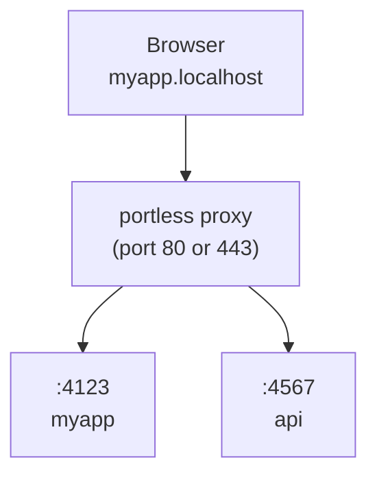

# @enk0ded/portless

Replace port numbers with stable, named .localhost URLs for local development. For humans and agents.

<p>
  <a href="https://www.npmjs.com/package/@enk0ded/portless"></a>
  <a href="https://github.com/ENK0DED/portless/blob/main/LICENSE"></a>
  <a href="https://www.npmjs.com/package/@enk0ded/portless"></a>
</p>

```diff
- "dev": "next dev"                  # http://localhost:3000
+ "dev": "portless run next dev"     # https://myapp.localhost
```

## Install

**Global (recommended):**

```bash
npm install -g @enk0ded/portless
```

**Or as a project dev dependency:**

```bash
npm install -D @enk0ded/portless
```

> portless is pre-1.0. When installed per-project, different contributors may run different versions. The state directory format may change between releases, which can require re-running `portless trust`.

This README describes the ENK0DED fork published as `@enk0ded/portless`. The CLI command is still `portless`, but install, release, and local dependency checks use the scoped package name.

## Run your app

```bash
portless myapp next dev
# -> https://myapp.localhost
```

HTTPS with HTTP/2 is enabled by default. On first run, portless generates a local CA, trusts it, and binds port 443 (auto-elevates with sudo on macOS/Linux). Generated CA and server certificates are stored in the resolved state directory and reused across restarts. Use `--skip-trust` when you want certificate files without adding the CA to the trust store, or `--no-tls` for plain HTTP.

The proxy auto-starts when you run an app. A port in the 4000 to 4999 range that is free on `127.0.0.1` is assigned via the `PORT` environment variable, random by default (`appPortStrategy` makes it stable per app or sequential). Portless skips browser-blocked ports during auto-assignment and rejects them for fixed app ports. Most frameworks (Next.js, Express, Nuxt, etc.) respect this automatically. For frameworks that ignore `PORT` (Vite, VitePlus, VitePress, Astro, React Router, Angular, Laravel, Expo, React Native, Wrangler, vinext), portless auto-injects the right `--port` flag and, when needed, a matching `--host` flag, Wrangler's `--ip` flag, or `--hostname` for `vinext start` (which otherwise binds `0.0.0.0`). Injection looks through package runners (`npx`, `bunx`, `pnpm exec`, `yarn dlx`, `npm exec`, `npm x`). For `npm exec` the flags go after a `--` so npm does not read them itself, and a command where npm might take the next word as an option value is left alone. `vitepress` is treated as a dev server for `dev`, `serve`, `preview` and a bare invocation, and `astro --root apps/web dev` finds its subcommand after leading global options. Commands run with your `PATH` first, the project's `node_modules/.bin` ahead of it, and portless's own Node directory last as a fallback for Windows `.cmd` wrappers, so a Node chosen by a version manager is never shadowed.

When sharing is active (Tailscale, ngrok, a managed tunnel, or NetBird), portless also lists the exact sharing hostnames, plus any configured suffix Vite does not already allow (`localhost` and `*.localhost` are always allowed), in `__VITE_ADDITIONAL_SERVER_ALLOWED_HOSTS`. Vite 8.1 and later split that value on commas. Older Vite reads it as one host, so with more than one entry portless passes a single host (a sharing hostname first) and prints a notice naming the rest; add those to `server.allowedHosts` in your Vite config or use Vite 8.1 or later.

Injection also reaches through a safe `bun run`, `npm run`, `pnpm run`, or `yarn run` script when its command resolves directly to a recognized framework or package runner. Only server commands receive flags: `dev`, `serve`, `preview`, `start`, `php artisan serve`, `wrangler dev`, and bare server invocations such as `vite` or `vite [root]`. Builds, checks, comments, compound commands, scripts with their own `--` terminator, environment-prefixed or delegated commands, and runner flags before the script name are left unchanged. Set the port in those scripts yourself.

For other tools, use exact command placeholders. Portless replaces whole arguments matching `{PORT}`, `{HOST}`, or `{PORTLESS_URL}` after assigning the app port and before spawning the child process. When any placeholder is present, automatic framework flag injection is skipped.

```bash
portless run my-server --port {PORT} --host {HOST} --url {PORTLESS_URL}
```

If a wrapped command self-daemonizes (its launcher exits, often with code 0, while a server it started keeps listening on the assigned port), portless keeps the route pointed at that server and prints its PID instead of removing the route. `astro dev` does this when it detects an agent. A clean exit waits up to 2 seconds for a server that binds late. The route belongs to that server from then on and goes away when it stops, so the dev server is not stopped for you: stop it with `kill <pid>`. A listener that already held the port before the command ran is never adopted, a command stopped by a signal (Ctrl+C) removes its route as usual, and `portless bg start` runs keep their bg-managed route. Sharing (Tailscale, ngrok, NetBird, tunnels) ends with the command, so a kept route is local only.

When auto-starting, portless reuses the configuration (port, TLS, suffix) from the most recent proxy run, so a restart or reboot does not silently revert to defaults. Explicit env vars (`PORTLESS_PORT`, `PORTLESS_HTTPS`, etc.) always take priority.

Portless stores per-user state in `~/.portless`. When the proxy runs under sudo, it resolves this path from the invoking user's home so the proxy and unprivileged app processes share the same route registrations.

In non-interactive environments (no TTY, or `CI=1`), portless exits with a descriptive error instead of prompting, so task runners like turborepo and CI scripts fail early with a clear message.

## Configuration

Bare `portless` works out of the box. It runs the `"dev"` script from `package.json` through the proxy, inferring the app name from the package name, git root, or directory:

```bash
portless        # -> runs "dev" script, https://<project>.localhost
```

Use an optional `portless.json` or `.config/portless.json` to override defaults:

```json
{ "name": "myapp" }
```

```bash
portless        # -> runs "dev" script, https://myapp.localhost
```

The script defaults to `"dev"`. The name is inferred from `package.json` if not set in config.

### Monorepo

One portless config file at the repo root covers all workspace packages. Portless discovers packages from `pnpm-workspace.yaml`, or the `"workspaces"` field in `package.json` (npm, yarn, bun):

```json
{
  "apps": {
    "apps/web": { "name": "myapp", "path": "/" },
    "apps/api": { "name": "myapp", "path": "/api" }
  }
}
```

```bash
portless        # from repo root: starts all workspace packages with a "dev" script
cd apps/web && portless   # start just one package
```

The `apps` map is optional. Packages not listed still auto-discover with names inferred from their `package.json`. Apps may share a `name` when each uses a distinct `path`, which places several workspace apps under one hostname. Paths used as `apps` keys are always relative to the repo root, even if the config file lives in `.config/`.

Without an `apps` map, hostnames follow the `<package>.<project>.localhost` convention. The project name comes from the most common npm scope across workspace packages (e.g. `@myorg/web` and `@myorg/api` produce `myorg`), falling back to the workspace root directory name. If a package's short name matches the project name, it gets the bare `<project>.localhost` without duplication.

In linked git worktrees, workspace URLs also get the branch prefix. For example, `apps/web` on branch `fix-ui` becomes `fix-ui.web.myorg.localhost`, and an `apps` override such as `api.myapp` becomes `fix-ui.api.myapp.localhost`.

### Referencing another app

A service that calls another service cannot hardcode its hostname, because the worktree prefix moves it. A monorepo run therefore gives every proxied app the URL of every proxied app, itself included:

```bash
PORTLESS_URL_WEB_MYREPO=https://fix-ui.web.myrepo.localhost
PORTLESS_URL_API_MYREPO=https://fix-ui.api.myrepo.localhost
```

The variable is named from the app name before any worktree prefix, uppercased, with dots and dashes as underscores (`api.myrepo` becomes `PORTLESS_URL_API_MYREPO`). The name is the same in every worktree while the URL it holds carries the branch prefix, so the reference can live in committed config:

```ts
const api = process.env.PORTLESS_URL_API_MYREPO ?? "https://api.myrepo.localhost";
```

When several apps share one hostname at different paths, each variable must still name exactly one app. The app at the root path keeps the plain name, and every other one appends its path, uppercased the same way, and its value includes that path:

```bash
# apps: site.myrepo at "/", site.myrepo at "/api"
PORTLESS_URL_SITE_MYREPO=https://fix-ui.site.myrepo.localhost
PORTLESS_URL_SITE_MYREPO_API=https://fix-ui.site.myrepo.localhost/api
```

An app alone on its hostname keeps the plain name even when it has a path, and the path is in the value. Names that still collapse to one variable (`web.api` and `web-api`, or `/a-b` and `/a/b` on one host) keep the first app, in label order, and portless warns about the rest rather than handing out the wrong URL. An app whose command is itself `portless` registers its own route, so it gets no variable, and apps that are not served through the proxy (tasks) receive none. Sharing URLs such as `PORTLESS_TAILSCALE_URL` stay per app and are not part of the map. Outside a monorepo run, `portless get <name>` prints the same URL:

```bash
API_URL=$(portless get api.myrepo)
```

### Config fields

| Field             | Type                                     | Default          | Description                                                            |
| ----------------- | ---------------------------------------- | ---------------- | ---------------------------------------------------------------------- |
| `name`            | string                                   | inferred         | Base app name. Worktree prefix still applies.                          |
| `script`          | string                                   | `"dev"`          | Name of a `package.json` script to run.                                |
| `appPort`         | number                                   | auto             | Fixed port for the child process. Browser-blocked ports are rejected.  |
| `appPortStrategy` | `"random"`, `"stable"` or `"sequential"` | `"random"`       | How the port is picked when `appPort` is not set.                      |
| `appPortRange`    | `[min, max]`                             | `[4000, 4999]`   | Inclusive range the strategy picks from. Must start at 1024 or higher. |
| `path`            | string                                   | `"/"`            | Route path prefix.                                                     |
| `proxy`           | boolean                                  | auto             | Whether to route through the proxy. Auto-detected.                     |
| `worktreeFlat`    | boolean                                  | `false`          | Join worktree and app labels into one DNS label.                       |
| `worktreeBranch`  | `"last-segment"` or `"full"`             | `"last-segment"` | How a branch name becomes the worktree prefix.                         |
| `apps`            | object                                   |                  | Overrides for workspace packages, keyed by relative path.              |
| `turbo`           | boolean                                  | `true`           | Set `false` to use direct spawning instead of turborepo.               |

### App port strategy

By default an app gets a random free port in 4000 to 4999. Set `appPortStrategy` and `appPortRange` to change that, in `portless.json`, the `package.json` `"portless"` key, or an `apps` entry:

- `random` (default): any free port in the range.
- `stable`: the port is derived from the app name (worktree prefix included) and its route path, so a checkout gets the same port across restarts and different checkouts spread across the range. If that port is taken, the next free one after it is used, wrapping around.
- `sequential`: the lowest free port in the range, so the first app on a machine gets the bottom. Ports that other routes already own are skipped even before their app has bound them.

```json
{ "appPortStrategy": "stable", "appPortRange": [4200, 4999] }
```

`PORTLESS_APP_PORT_STRATEGY` and `PORTLESS_APP_PORT_RANGE` (written `4200-4999`) override the files, each on its own. A fixed port always wins, in this order: `--app-port`, `PORTLESS_APP_PORT`, then a config `appPort`; those skip the strategy entirely. Putting `appPort` next to `appPortStrategy` or `appPortRange` in one object is an error. In a workspace with an `apps` map, a top-level strategy and range are the default for every app that does not fix a port, and an app entry or its `package.json` key overrides them. The range must start at 1024 or higher, because apps cannot bind lower ports without privileges, and browser-blocked ports are skipped in every strategy. Stable ports are not reserved: an app that finds its port taken falls forward, so the guarantee is "same port when it is free". `portless bg start` saves the exported strategy and range in the app's intent, and `bg restart` replays them even from a shell without the variables.

### package.json "portless" key

Instead of a separate config file, you can add a `"portless"` key to your `package.json`. A string value is shorthand for setting the name:

```json
{
  "name": "@myorg/web",
  "portless": "myapp"
}
```

An object supports all per-app fields (`name`, `script`, `appPort`, `appPortStrategy`, `appPortRange`, `path`, `proxy`, `worktreeFlat`, `worktreeBranch`):

```json
{
  "name": "@myorg/web",
  "portless": { "name": "myapp", "script": "dev:app" }
}
```

Lookup order is:

1. `portless.json`
2. `.config/portless.json`
3. `package.json` `"portless"` key

For workspace package settings, a package's own `package.json` `"portless"` key takes precedence over the root config's `apps` entry. Route path precedence is `--path`, then `PORTLESS_PATH`, then per-app config. A set `PORTLESS_PATH` applies to every workspace app; unset it to use distinct configured paths.

### --script flag

Override the default script for a single invocation:

```bash
portless --script start       # run "start" instead of "dev"
portless --script test        # run "test" instead of "dev"
```

### Turborepo

To use portless with turborepo, put `portless` as the `dev` script and the real command in a separate script:

```json
{
  "scripts": {
    "dev": "portless",
    "dev:app": "next dev"
  },
  "portless": { "name": "myapp", "script": "dev:app" }
}
```

Turbo runs each package's `dev` script, which invokes portless. Portless reads the config, detects the package manager, and runs `bun run dev:app` (or npm/yarn/pnpm) through the proxy. No changes to `turbo.json` are needed.

`bun dev` at the root works through turbo as usual. People without portless can run `bun run dev:app` directly.

When `portless` runs from a workspace root, it uses the existing Turbo integration to preserve task ordering when either `turbo.json` or `turbo.jsonc` is readable. Set `"turbo": false` in the root portless configuration to use direct spawning instead.

## Use in package.json

You can still use portless in `package.json` scripts:

```json
{
  "scripts": {
    "dev": "portless run next dev"
  }
}
```

With a portless config file, you can simplify to:

```json
{
  "scripts": {
    "dev": "next dev"
  }
}
```

Then run `portless` or `portless run` to go through the proxy.

When you press Ctrl+C, portless forwards the interrupt and waits for the command's process tree to
exit. Press Ctrl+C again to forward another interrupt. Any remaining descendants are sent SIGTERM
after 5 seconds and SIGKILL after 10 seconds. On Windows, the process tree is ended with
`taskkill /T`, and a small watcher process ends it if portless itself is force-killed.

If portless is killed without running its cleanup (SIGKILL, a crash), the command it started can keep
running. portless records that command's process group and start time on the route. The next
`portless run`, or `portless prune`, stops the group, and only while its leader still has the recorded
start time, so a reused process ID is never targeted. The proxy's background sweep never kills
anything: it keeps such a route on file as orphaned, and `portless list` and the dashboard show it
until you run or prune. The proxy does not serve an orphaned route: it checks route owners about
once a second and answers 404 for the hostname as soon as the owner is gone, without writing the
routes file. In the same check it stops the sharing the dead owner started for that route (managed
tunnel, Tailscale serve, NetBird), once per death, so a public URL closes within about a second
instead of waiting for the sweep. Only sharing helpers are stopped, never the dev server. Process groups do not exist on Windows, so this recovery is Unix only.

## Subdomains

Organize services with subdomains:

```bash
portless api.myapp bun start
# -> https://api.myapp.localhost

portless docs.myapp next dev
# -> https://docs.myapp.localhost
```

By default, only explicitly registered subdomains are routed (strict mode). Use `--wildcard` when starting the proxy to allow any subdomain of a registered route to fall back to that app (e.g. `tenant1.myapp.localhost` routes to the `myapp` app without extra registration). Wildcard routing is local proxy behavior only; mDNS LAN mode cannot resolve wildcard subdomains on other devices. When several registered hostnames could answer a wildcard request, the longest (most specific) parent hostname wins, then the longest path prefix within it, so `admin.api.acme.localhost` reaches `api.acme.localhost` rather than `acme.localhost` whichever was registered first. To change wildcard mode for a running proxy, stop it and start it again with the desired mode.

## Git Worktrees

`portless run` automatically detects git worktrees. In a linked worktree, the branch name is prepended as a subdomain so each worktree gets its own URL without any config changes:

```bash
# Main worktree (no prefix)
portless run next dev   # -> https://myapp.localhost

# Linked worktree on branch "fix-ui"
portless run next dev   # -> https://fix-ui.myapp.localhost
```

Use `--name` to override the inferred base name while keeping the worktree prefix:

```bash
portless run --name myapp next dev   # -> https://fix-ui.myapp.localhost
```

Put `portless run` in your `package.json` once and it works everywhere. The main checkout uses the plain name, each worktree gets a unique subdomain. No collisions, no `--force`.

Monorepo workspace apps use the same prefixing rule, including names set through the root `apps` map.

When a single-level wildcard certificate is required, set `worktreeFlat` in the project config. This joins the worktree and app labels into one DNS label and adds a short hash when the source labels could otherwise collide:

```json
{ "worktreeFlat": true }
```

```bash
PORTLESS_WORKTREE_FLAT=1 portless run next dev
# -> https://fix-ui-myapp.localhost
```

`PORTLESS_WORKTREE_FLAT=0` disables flat mode for a shell even when the project config enables it. The environment setting overrides `worktreeFlat` for both the CLI and `getUrl()`.

### Choosing the prefix

By default the prefix is the last segment of the branch name, so `team-a/login` becomes `login`. Set `worktreeBranch` to `"full"` to sanitize the whole branch name instead (`team-a/login` becomes `team-a-login`). It is valid at the top level and per app, and an app's value overrides the top-level one:

```json
{ "worktreeBranch": "full" }
```

`main` and `master` never get a derived prefix. The check uses the whole branch name, so `feature/main` still gets one. Long names are shortened to a legal DNS label. In flat mode, any prefix containing a hyphen (every `"full"` prefix with a slash in the branch, and any explicit prefix such as `qa-1`) gets the short collision hash.

To set the prefix yourself, use `--worktree-prefix`. An explicit prefix applies everywhere: a linked worktree, the main checkout, a default branch, and directories outside git:

```bash
portless run --worktree-prefix qa next dev   # -> https://qa.myapp.localhost
portless --worktree-prefix qa                # bare mode, single app or workspace root
portless get myapp --worktree-prefix qa      # -> https://qa.myapp.localhost
PORTLESS_WORKTREE_PREFIX=qa portless run next dev
```

To turn the prefix off, use `--no-worktree` on `run`, bare `portless`, or `get`, or set `PORTLESS_WORKTREE_PREFIX=` (empty) for a shell:

```bash
portless run --no-worktree next dev   # -> https://myapp.localhost even in a linked worktree
```

The prefix is chosen by, in order: the flag, then `PORTLESS_WORKTREE_PREFIX`, then git detection. A flag wins over the variable in both directions, so `--worktree-prefix qa` beats an empty variable and `--no-worktree` beats a set one. `--worktree-prefix ""` and values that sanitize to nothing (such as `///`) exit with an error, and `--no-worktree` with `--worktree-prefix` is an error. `portless bg start` saves the resolved decision, so `bg restart` replays it without the variable. This fork does not accept upstream's `--prefix` or `PORTLESS_PREFIX`; `--path` and `PORTLESS_PATH` stay the route path prefix.

## Custom Suffixes

By default, portless uses the `localhost` suffix, which produces URLs like `https://myapp.localhost` and auto-resolves to `127.0.0.1` in most browsers. This fork uses "suffix" terminology because the value can be more than a single top-level label.

For one-off proxy starts, prefer repeatable `--suffix` flags:

```bash
portless proxy start --suffix test
portless myapp next dev
# -> https://myapp.test
```

Repeat the flag to serve every app under multiple suffixes. Comma-separated values are also accepted:

```bash
portless proxy start --suffix test --suffix local.example.com
# -> https://myapp.test and https://myapp.local.example.com
```

For shell or service configuration, prefer `PORTLESS_SUFFIX`:

```bash
PORTLESS_SUFFIX=test portless proxy start
portless myapp next dev
# -> https://myapp.test
```

`PORTLESS_SUFFIX` accepts a comma-separated list. Each member may be a single label such as `test` or a dotted suffix such as `server01.acme.com`:

```bash
PORTLESS_SUFFIX=test,server01.acme.com portless proxy start
portless myapp next dev
# -> https://myapp.test and https://myapp.server01.acme.com
```

`PORTLESS_SUFFIX` is read before the legacy `PORTLESS_TLD` variable. If both are set, the complete `PORTLESS_SUFFIX` list wins. `PORTLESS_TLD` and repeatable `--tld` remain supported so existing upstream-style environments and scripts keep working.

In LAN mode, an explicit suffix list is preserved and `.local` is appended when absent. Plain `--lan` without an explicit suffix still uses only `.local`. Only `.local` names are published through mDNS.

Suffix values are lowercased and validated as DNS names: each label may contain lowercase letters, digits, and hyphens, must start and end with a letter or digit, and must be 63 characters or less. The full suffix and generated hostname must be 253 characters or less. Leading dots, trailing dots, and consecutive dots are rejected.

Auto-elevated proxy starts pass the resolved `PORTLESS_STATE_DIR` and proxy flags such as `--skip-trust` through `sudo`, so a root-owned proxy uses the same per-user state, suffix settings, and trust choice as the command that started it. Set `PORTLESS_STATE_DIR` explicitly before running portless if you want a separate proxy state directory. A state directory without a port file counts as having no proxy: portless does not fall back to probing the default port, so a fresh isolated directory never reaches another proxy running on this machine. This holds for every command: `proxy stop` without `-p` reports "Proxy is not running.", `doctor` reports the proxy as not running, and the restart hint after `trust` regenerates the CA stays silent, all without opening a connection. A state directory tracks one proxy: `proxy start -p <other port>` exits 1 while a live proxy is tracked there (give a second proxy its own `PORTLESS_STATE_DIR`), and `proxy stop -p <port>` stops only the proxy on that port without clearing the state of the tracked one.

The proxy auto-syncs `/etc/hosts` for route hostnames, so `.test`, `.server01.acme.com`, and other configured suffixes resolve on your machine.

The proxy also sweeps `routes.json` for entries whose owning process has died. This protects against clients killed before their exit cleanup runs. The sweep runs every 300 seconds by default; use `--routes-cleanup-interval <seconds>` or `PORTLESS_ROUTES_CLEANUP_INTERVAL=<seconds>` to change it. Set either value to `0` to disable the sweep. The sweep removes stale route records and sharing metadata without killing the app process behind a route's port.

Recommended: `.test` for throwaway local names because it is IANA-reserved. Use a subdomain you control, such as `local.example.com`, when OAuth providers or other external systems require a public suffix. Avoid `.local` outside LAN mode because it conflicts with mDNS/Bonjour. Avoid bare public suffixes like `.dev` unless you understand the collision and HSTS implications.

## How it works



1. **Start the proxy**: auto-starts when you run an app, or start explicitly with `portless proxy start`
2. **Run apps**: `portless <name> <command>` assigns a free port and registers with the proxy
3. **Access via URL**: `https://<name>.localhost` routes through the proxy to your app

By default, outside LAN mode, the proxy and its HTTP redirect listener bind only to the IPv4 and IPv6 loopback addresses, `127.0.0.1` and `::1`. They do not accept connections through LAN, VPN, or other network interfaces.

When portless itself returns an error (404 for an unknown host, 421 for a misdirected request, 502 when the app is unreachable, 508 for a request loop), browsers get a branded HTML page. Any client whose `Accept` header does not include `text/html`, such as curl or `fetch`, gets a small JSON body instead: `{"error":"bad_gateway","upstream":"myapp.localhost","message":"..."}`, where `error` is `not_found`, `misdirected_request`, `bad_gateway`, or `loop_detected` and `message` carries the hint (the target port and `portless list` for a 502, the `portless <name> your-command` registration command for a 404). Both representations send `Vary: Accept`. Responses from your own app are forwarded unchanged.

A hostname outside every configured suffix, for example a site a DNS blocklist points at 127.0.0.1, gets 421 Misdirected Request with no app list, so a misdirected client cannot read your route names. A public tunnel or Tailscale hostname whose path matches no route gets a plain 404 without the app list as well. Under a configured suffix, an unknown name gets the 404 page listing active apps with their uptime; with more than five apps the page adds a hostname filter and a "Newest first" toggle.

## HTTP/2 + HTTPS

HTTPS with HTTP/2 is enabled by default. Browsers limit HTTP/1.1 to 6 connections per host, which bottlenecks dev servers that serve many unbundled files (Vite, Nuxt, etc.). HTTP/2 multiplexes all requests over a single connection.

Portless also supports modern browser HMR WebSockets over HTTP/2 using RFC 8441 Extended CONNECT, including negotiated WebSocket subprotocols such as Vite's `vite-hmr`, so Next.js Turbopack, Vite, Nuxt, and similar dev servers can keep hot reloading while HTTPS/HTTP/2 is enabled.

On first run, portless generates a local CA and adds it to your system trust store. The generated CA, server certificate, and per-host certificates live under `~/.portless` by default and are reused across proxy restarts and machine reboots. They are regenerated only when removed or cleaned. No browser warnings. No manual setup.

## Unprivileged mode

Portless probes its listener addresses before elevating with `sudo` for bind permissions. It also elevates when automatic hosts sync is enabled and a configured suffix needs hosts entries, so `-p 1355` with a custom suffix still asks for sudo; set `PORTLESS_SYNC_HOSTS=0`, pass `--unprivileged`, or keep the default `.localhost` suffix to avoid it. If sudo fails, startup exits without falling back to another port. On a machine where that is not an option, such as a managed laptop, a CI runner, or an agent session with no terminal to type a password into, start the proxy with `--unprivileged`:

```bash
portless proxy start --unprivileged
# -> http://myapp.localhost, no sudo prompt, nothing installed
```

macOS lets a non-root process bind a port below 1024 only on the wildcard address, so the proxy binds `0.0.0.0` and `::` instead of the loopback addresses and then refuses every connection whose peer is not loopback itself, at accept time and again per request and per upgrade. The result is the same loopback-only proxy, obtained without root. Windows has no privileged-port rule, so the flag only changes the bind address there. Linux moves the boundary with a sysctl; portless checks it and stops with the exact command when the port is still out of reach, rather than falling back to another port:

```bash
sudo sysctl -w net.ipv4.ip_unprivileged_port_start=80   # once per machine
```

The mode promises no prompt of any kind, so it serves plain HTTP on port 80 by default: installing the generated CA into the trust store would be a prompt. `*.localhost` is a secure context either way, so `Secure` cookies and service workers work over HTTP. Pass `--https` to keep HTTPS on 443; the CA is generated but never installed by this mode, so browsers warn until you run `portless trust` once yourself.

It never writes the hosts file either, since that needs root: automatic hosts sync is off in this mode, and `PORTLESS_SYNC_HOSTS=1` together with it is refused. `.localhost` names resolve in browsers without it. For Safari or a custom TLD, run `sudo portless hosts sync` once yourself; a custom TLD says so when the proxy starts.

The mode is remembered in the state directory, so auto-start reuses it, and `PORTLESS_UNPRIVILEGED=1` selects it without the flag. Use `PORTLESS_UNPRIVILEGED=0` for a start to switch back. It never asks for `sudo`, which also means the no-TTY exit does not apply: a proxy can be auto-started from a script or an agent on a fresh machine. In LAN mode the flag only removes the sudo step, since LAN mode wants remote peers. Under `service install` the service still runs as root, so the flag does not remove a prompt there, but it keeps its other effects: plain HTTP on port 80 unless `--https` is given, hosts sync off, and loopback peers only unless LAN mode is enabled.

On a Mac with the application firewall turned on, the first wildcard bind shows an "allow incoming connections" prompt for Node. No password, and the proxy still refuses non-loopback peers whatever you answer.

```bash
# Use your own certs (e.g., from mkcert)
portless proxy start --cert ./cert.pem --key ./key.pem

# Generate or reuse certs without adding the CA to the trust store
portless proxy start --skip-trust

# Disable HTTPS (plain HTTP on port 80)
portless proxy start --no-tls

# If you skipped the trust prompt on first run, trust the CA later
portless trust
```

On Linux, `portless trust` supports Debian/Ubuntu, Arch, Fedora/RHEL/CentOS, and openSUSE (via `update-ca-certificates` or `update-ca-trust`). NixOS and unrecognized Linux distributions receive manual setup guidance instead of being written to an unsupported trust layout. On Windows, it uses `certutil` to add the CA to the system trust store. In WSL, portless also installs the CA into the Windows CurrentUser Root store so Windows browsers trust WSL-served portless HTTPS URLs. Linux containers on a WSL2 host use only the Linux trust store.

On Linux, portless also trusts the CA in the invoking user's existing Chrome/Chromium NSS database (also under `sudo`): `~/.pki/nssdb` if present, otherwise `~/.local/share/pki/nssdb` (Chromium M146+). This needs NSS `certutil`: install `libnss3-tools` on Debian/Ubuntu, `nss-tools` on Fedora/RHEL, `nss` on Arch, or `mozilla-nss-tools` on openSUSE, then run `portless trust` and restart the browser. No NSS database is created; if neither path exists, open Chrome once and rerun `portless trust`. In WSL the NSS database is updated as well, whichever of the Linux and Windows stores succeeded. `portless clean` removes the CA from the active NSS database too.

If NSS registration fails, the system trust that succeeded is kept and `portless trust` exits successfully with a browser-trust warning, and `portless doctor` reports incomplete trust until the NSS entry verifies. A missing `certutil` is different: when an NSS database exists but `certutil` is not installed, portless cannot read or write it, so it only warns that Chrome needs `certutil` to trust the CA (from `portless trust`, from the first trust attempt, and from `portless doctor`). That warning never counts as incomplete trust, so it does not block the `portless trust` skip below, make `proxy start` retry trust every time, or fail `doctor`. Install the NSS tools and rerun `portless trust` to finish. If NSS removal fails during `portless clean`, the CA certificate and key are kept for a retry.

`portless trust` does nothing when every store it writes already has the CA (both the Linux and Windows stores on WSL, plus the NSS database on Linux when one exists), so setup scripts can run it every time without a prompt. It checks the stores themselves rather than the trust marker, so it still repairs a CA that was removed.

### Trust the CA on other devices

`portless trust` installs the CA on the machine running portless. To trust it on another device — a phone testing over [LAN mode](#lan-mode), a second machine, or a browser with its own trust store — open the certificate page the proxy serves in the browser:

```text
https://cert.localhost          # or cert.<suffix> for a custom suffix
```

The page offers the **public** CA certificate for download (`/portless-ca.pem`), shows its SHA-256 fingerprint so you can verify it, and gives step-by-step install instructions for macOS, Linux, Windows, and Firefox. Only the public certificate is ever served — the CA private key never leaves the machine that generated it. Install a CA only on devices you control: it can vouch for any HTTPS site to that device.

HTTP/1.1 backend connections are pooled with up to 16 simultaneous connection attempts per app and 64 idle sockets. Established streams do not count toward the dial limit. A connection attempt times out after 10 seconds; established streams have no proxy timeout. Proxy shutdown rejects queued requests with status 503.

### h2c and gRPC upstreams

By default, portless forwards each route to the local app with HTTP/1.1. Use `--h2c` only when the upstream app expects HTTP/2 cleartext, such as a local gRPC service:

```bash
portless grpc --h2c bun run grpc-server
portless alias grpc 50051 --h2c
PORTLESS_H2C=1 portless run bun run grpc-server
```

`--h2c` changes only the loopback connection from portless to the local app. Browser-facing HTTPS, route names, sharing modes, and loopback-only child app binding keep their existing defaults. There is no automatic protocol probing.

### Path-based routes

By default, each hostname routes from `/`. Use `--path <prefix>` when you want multiple local apps under one hostname, such as an API and docs service:

```bash
portless myapp --path /api bun run api
portless myapp --path /docs bun run docs
portless alias myapp 4100 --path /legacy
PORTLESS_PATH=/api portless run bun run api
```

Path routing is explicit and boundary-aware. `/api` matches `/api` and `/api/users`, but not `/api-v2`. Portless forwards the full request path unchanged, so the upstream app still receives `/api/users`.

Configured prefixes must begin with `/` and use RFC 3986 path characters. Portless rejects spaces, backslashes, empty or dot-only segments, malformed percent escapes, and percent-encoded slashes or dots. Trailing slashes are normalized away. Printed local and sharing URLs include the configured prefix.

## Start at OS startup

Install the proxy as an OS startup service so clean HTTPS URLs are available after reboot without starting the proxy from a terminal:

```bash
portless service install
portless service install --lan
portless service install --wildcard
PORTLESS_STATE_DIR=~/.portless-lan PORTLESS_LAN=1 portless service install
portless service status
portless service uninstall
```

The service uses portless defaults unless install options or `PORTLESS_*` environment variables are provided: HTTPS on port 443 with `.localhost` names. `service install` accepts the proxy options you would use with `proxy start`, including `--port`, `--no-tls`, `--lan`, `--ip`, `--suffix`, `--tld`, `--wildcard`, `--cert`, and `--key`. Use `--state-dir <path>` or `PORTLESS_STATE_DIR=<path>` to choose where service state and logs are written.

The chosen service configuration is written into launchd, systemd, or Task Scheduler and reused after reboot. Custom service suffix lists are persisted as `PORTLESS_SUFFIX`; `--suffix` and `--tld` may repeat. `portless service status` reports the installed port, HTTPS mode, configured suffixes, LAN mode, wildcard mode, state directory, and the Node binary the service pins, flagging it when that binary no longer exists (re-run `portless service install` to repair). macOS and Linux install a root-owned service so port 443 can bind at boot. Windows installs a Task Scheduler startup task that runs as SYSTEM. Installation and removal may require administrator privileges. `portless clean` automatically removes the service.

## LAN mode

```bash
portless proxy start --lan
portless proxy start --lan --https
portless proxy start --lan --ip 192.168.1.42
```

`--lan` explicitly binds the proxy to the IPv4 and IPv6 unspecified addresses, `0.0.0.0` and `::`, and switches to mDNS discovery. This makes services available as `<name>.local` to devices on the same network. Portless auto-detects your LAN IP and follows Wi-Fi/IP changes automatically, but you can pin another address with `--ip <address>` or by exporting `PORTLESS_LAN_IP`. Set `PORTLESS_LAN=1` in your shell (0/1 boolean) to make LAN mode the default whenever the proxy starts.

Portless remembers LAN mode via `proxy.lan`, so if you stop a LAN proxy and start it again, it stays in LAN mode. All proxy settings (port, TLS, suffix, LAN) are persisted and reused on auto-start unless overridden by explicit flags or env vars. Use `PORTLESS_LAN=0` for one start to switch back to `.localhost` mode. If a proxy is already running with different explicit LAN, TLS, or suffix settings, portless warns and asks you to stop it first.

LAN mode depends on the system mDNS tools that portless already spawns: macOS ships with `dns-sd`, while Linux uses `avahi-publish-address` from `avahi-utils` (install via `sudo apt install avahi-utils` or your distro’s equivalent). If the command is missing or your network isn’t reachable, `portless proxy start --lan` prints the relevant error and exits.

### Framework notes

- **Next.js**: add your `.local` hostnames to `allowedDevOrigins`:

  ```js
  // next.config.js
  module.exports = {
    allowedDevOrigins: ["myapp.local", "*.myapp.local"],
  };
  ```

- **Expo / React Native**: portless always injects `--port`. React Native also gets `--host 127.0.0.1`. Expo gets `--host localhost` outside LAN mode, but in LAN mode portless leaves Metro on its default LAN host behavior instead of forcing `--host` or `HOST`.
- **Laravel / Wrangler**: Laravel's `php artisan serve` gets `--port` and `--host 127.0.0.1`. Wrangler gets `--port` and `--ip 127.0.0.1` because Wrangler's `--host` option means route hostname, not bind address.

## Tailscale sharing

Share your dev server with teammates on your [Tailscale](https://tailscale.com) network:

```bash
portless myapp --tailscale next dev
# -> https://myapp.localhost           (local)
# -> https://devbox.yourteam.ts.net    (tailnet)
```

Each `--tailscale` app is root-mounted on its own Tailscale HTTPS port, so no framework `basePath` configuration is needed. The first app gets port 443, subsequent apps get 8443, 8444, etc.

Requests arriving with a route's persisted Tailscale Serve or Funnel hostname are routed to that app. Tailscale Service hostnames work the same way. Matching is exact, so an unrelated `.ts.net` hostname is rejected.

```bash
portless myapp --tailscale next dev     # -> https://devbox.ts.net
portless api --tailscale bun start     # -> https://devbox.ts.net:8443
```

Use `--tailscale-service` for a stable [Tailscale Service](https://tailscale.com/docs/features/tailscale-services) MagicDNS name:

```bash
portless myapp --tailscale-service next dev
# -> https://myapp.yourteam.ts.net

portless myapp --tailscale-service --tailscale-service-name api next dev
# -> https://api.yourteam.ts.net
```

Tailscale Services are tailnet-scoped and do not imply Tailscale Funnel. They require a tagged device identity and may need admin approval before MagicDNS resolves. Portless records pending approval in `portless list` instead of claiming the URL is reachable.

Use `--funnel` to expose your dev server to the public internet via [Tailscale Funnel](https://tailscale.com/kb/1223/funnel/):

```bash
portless myapp --funnel next dev
# -> https://devbox.yourteam.ts.net    (public)
```

### Tailnets without MagicDNS

HTTPS sharing needs a certificate for the node's MagicDNS name, so `--tailscale`, `--tailscale-service`, and `--funnel` need MagicDNS. When the tailnet reports MagicDNS as off, portless exits before starting the child process instead of printing an `https://` URL that fails the TLS handshake. Some tailnets cannot enable MagicDNS, for example because it breaks split-horizon DNS. Use `--tailscale-http` there:

```bash
portless myapp --tailscale-http next dev
# -> https://myapp.localhost           (local)
# -> http://100.101.102.103            (tailnet)
```

This forwards a raw TCP port on the node straight to the app, addressed by the node's tailnet IP (or its MagicDNS name when the tailnet has one), so no certificate is involved. WireGuard encrypts all tailnet traffic, so the plain-HTTP hop exists only inside the tunnel. Browsers still treat a plain-HTTP tailnet URL as an insecure context: APIs that need a secure context (service workers, camera and microphone, `crypto.subtle`) are unavailable, and cookies marked `Secure` are not set. Apps get port 80 first, then 8080, 8081, and so on. Because the forward is raw TCP, the app does not receive the `Tailscale-User-*` and `X-Forwarded-*` headers that an HTTPS serve adds.

`--tailscale-http` cannot be combined with `--funnel` (Funnel has no plain-HTTP mode) or `--tailscale-service` (Services are HTTPS only). Set `PORTLESS_TAILSCALE_HTTP=1` to enable it for every app. It is cleaned up like any other tailnet share, including by `portless clean` and `portless prune` after a crash.

Tailscale HTTPS certificates must be enabled before `--tailscale`, `--tailscale-service`, or `--funnel` can register HTTPS URLs. Funnel must also be enabled for the tailnet and node before `--funnel` can register the public URL. If either setting is missing, portless exits before starting the child process.

Set `PORTLESS_TAILSCALE=1` in your shell profile or `.env` to share every app by default. `portless list` shows both local and tailnet URLs. Tailscale serve registrations are cleaned up automatically when the app exits.

The proxy routes exact requests for each persisted Serve, Funnel, or Service hostname to its registered app. It does not accept unrelated public Host values or wildcard-match other `.ts.net` names.

Requires the Tailscale CLI to be installed and connected (`tailscale up`). `--tailscale`, `--tailscale-service`, and `--funnel` also need MagicDNS and Tailscale HTTPS certificates enabled on the active tailnet; `--tailscale-http` needs neither.

## ngrok sharing

Expose your dev server to the public internet with [ngrok](https://ngrok.com):

```bash
portless myapp --ngrok next dev
# -> https://myapp.localhost           (local)
# -> https://abc123.ngrok.app          (public)
```

Set `PORTLESS_NGROK=1` in your shell profile or `.env` to enable ngrok by default when portless runs an app. `portless list` shows both local and ngrok URLs. The ngrok tunnel is cleaned up automatically when the app exits.

Requires the ngrok CLI to be installed and authenticated. If ngrok reports an authentication error, run `ngrok config add-authtoken <token>` and try again.

## Public tunnel aliases

Use managed tunnels to expose a public HTTPS URL directly to a child app:

```bash
portless myapp --tunnel cloudflare next dev
# -> https://myapp.localhost
# -> https://abc.trycloudflare.com

portless myapp --tunnel ngrok next dev
# -> https://abc123.ngrok.app
```

Managed tunnels are public. Portless keeps the child app bound to `127.0.0.1` and targets its app port directly, rewriting Host to the route hostname. Public requests bypass the portless proxy. A path-prefixed route still exposes the whole app, including paths outside the prefix; portless prints a notice when starting it. Manual aliases remain exact proxy routes; unknown public Host headers are rejected.

`--cloudflare` and `PORTLESS_CLOUDFLARE=1` are aliases of `--tunnel cloudflare`. Cloudflare children receive both `PORTLESS_TUNNEL_URL` and `PORTLESS_CLOUDFLARE_URL`. Cloudflare startup waits for a registered connection and uses an empty config in the portless state directory.

Use manual tunnel aliases when another tool already provides the public hostname:

```bash
portless tunnel map myapp abc.trycloudflare.com
portless tunnel map myapp public.example.com --path /api
portless tunnel list
portless tunnel unmap abc.trycloudflare.com
```

Cloudflare support uses [Cloudflare Quick Tunnels](https://developers.cloudflare.com/cloudflare-one/networks/connectors/cloudflare-tunnel/do-more-with-tunnels/trycloudflare/) through the `cloudflared` CLI. ngrok managed tunnels require the `ngrok` CLI and authentication. `--tunnel-hostname <hostname>` requests a provider-specific stable hostname when supported; Cloudflare Quick Tunnels do not support this mode.

## NetBird sharing

Expose your dev server to the public internet with [NetBird Peer Expose](https://docs.netbird.io/):

```bash
portless myapp --netbird next dev
# -> https://myapp.localhost           (local)
# -> https://myapp-a1b2c3.netbird.cloud (public)
```

NetBird URLs are public reverse proxy URLs. Use `--netbird-password`, `--netbird-pin`, or `--netbird-groups` to restrict access:

```bash
portless myapp --netbird --netbird-groups team next dev
portless myapp --netbird-password secret --netbird-pin 123456 next dev
```

Set `PORTLESS_NETBIRD=1` in your shell profile or `.env` to enable NetBird by default when portless runs an app. Setting `PORTLESS_NETBIRD_PASSWORD`, `PORTLESS_NETBIRD_PIN`, or `PORTLESS_NETBIRD_GROUPS` also enables NetBird sharing. `portless list` shows both local and NetBird URLs. The NetBird expose process is cleaned up automatically when the app exits.

Portless keeps the child app bound to `127.0.0.1` by default, even when NetBird sharing is active. The NetBird reverse proxy reaches the assigned local app port while the app itself is not opened on every network interface by portless.

Requires the NetBird CLI to be installed and connected, with Peer Expose enabled and allowed for the active peer.

## Background apps

Use `portless bg start` when a dev server should keep running after the shell command returns, such as agent workflows or long-lived local services:

```bash
portless bg start --name web bun run dev
portless bg status web
portless bg logs web --tail 100
portless bg stop web
```

`bg stop` sends SIGTERM and waits up to 12 seconds, so `portless run` can finish its own graceful shutdown (it sends SIGKILL after 10 seconds). `bg stop --force` sends SIGKILL to the app and also to the command it started, when that process group is still the one recorded on the route.

Background app management currently supports macOS and Linux. Windows support needs a separate process-group implementation.

`bg start` waits up to 30 seconds for the route to become ready by default. Use `--wait <seconds>` to customize the timeout, `--no-wait` to return immediately after spawning, or `--keep` to leave a timed-out child running for manual inspection. A timed-out child is stopped by default so stale routes are not left behind accidentally.

Background apps preserve the normal `portless run` feature set, including `--path`, `--worktree-prefix`, `--no-worktree`, `PORTLESS_APP_PORT_STRATEGY` and `PORTLESS_APP_PORT_RANGE` (saved when the app starts and replayed by `bg restart`), `--h2c`, `--tunnel`, `--tailscale-service`, `--ngrok`, and `--netbird`. Backgrounding is not a sharing feature by itself: child apps still bind to loopback by default, and public exposure still requires explicit sharing flags.

Private stdout, stderr, and lifecycle logs are stored under `${PORTLESS_STATE_DIR:-~/.portless}/bg/logs` with owner-only permissions. Prefer `portless bg logs` over reading those files directly because logs can contain tokens, cookies, request bodies, stack traces, or private URLs.

Use `portless bg list` to see all registered background apps, `portless bg status [name]` for one app, `portless bg logs [name]` for logs, `portless bg restart [name]` to restart from the stored command intent, and `portless bg clean [name|--all]` to remove dead entries and their logs. `portless clean` stops registered background apps before removing state, and `portless prune` removes dead background entries without stopping live ones.

## Local dashboard

While the proxy runs it serves a small dashboard in the browser:

```text
https://portless.localhost      # or portless.<suffix> for a custom suffix
```

The dashboard lists every running app with its hostname, local port, and any public exposure (Tailscale, Funnel, ngrok, managed tunnels, NetBird), plus the proxy's suffix, protocol, and CA trust status. It links straight to the [certificate page](#trust-the-ca-on-other-devices) when the CA is not yet trusted.

It is intentionally **read-only**: it never controls processes from the browser (no cross-origin control surface). Each row opens the app or copies its URL with one click. The hostname is reserved and cannot be claimed by an app. The dashboard URL is printed when the proxy starts; disable the dashboard with `PORTLESS_DASHBOARD=0`.

## Multiplexed hostnames

Use `--multiplex` to let several apps share one hostname — for example two git worktrees of the same project, both reachable at `https://myapp.localhost`:

```bash
# from worktree A
portless myapp --multiplex -- npm run dev
# from worktree B
portless myapp --multiplex --label hotfix -- npm run dev
```

Each app gets a `--label` (default: the current directory name). Opening the shared hostname shows a portless app picker; your choice is remembered per hostname via a host-scoped cookie, and you can switch any time at `https://myapp.localhost/__portless/switch`. WebSocket connections follow the same cookie.

portless never modifies your app's HTML or response headers — the selection lives entirely in portless's own picker and redirect responses, so auth flows, cookies, and content stream through untouched. Without `--multiplex`, a hostname has a single owner exactly as before; the two modes cannot be mixed without `--force`. Env equivalents: `PORTLESS_MULTIPLEX=1` and `PORTLESS_LABEL=<label>`.

## Commands

```bash
portless                        # Run dev script through proxy
portless                        # From monorepo root: run all workspace packages
portless run [--name <name>] [cmd] [args...]  # Infer name, run through proxy
portless <name> <cmd> [args...]  # Run app at https://<name>.localhost
portless alias <name> <port>     # Register a static route (e.g. for Docker)
portless alias <name> <port> --force  # Overwrite an existing route
portless alias <name> <port> --h2c  # Register an HTTP/2 cleartext route
portless alias <name> <port> --path /api  # Register a path-scoped route
portless alias --remove <name>   # Remove a static route
portless tunnel map <route> <host>  # Map an exact public tunnel host
portless tunnel list             # Show public tunnel aliases
portless tunnel unmap <host>     # Remove a public tunnel alias
portless bg start [cmd]          # Start an app in the background
portless bg status [name]        # Show background app status
portless bg list                 # List background apps
portless bg logs [name]          # Print background app logs
portless bg stop [name]          # Stop a background app
portless bg restart [name]       # Restart a background app
portless bg clean [name]         # Remove dead background entries
portless get <name>              # Print URL for a service
portless get <name> --json       # Print service info as JSON
portless get <name> --worktree-prefix qa   # Use qa as the worktree prefix
portless get <name> --no-worktree          # Skip the worktree prefix
portless url <name>              # Alias for portless get
portless list                    # Show active routes and their uptime
portless list --json             # Show active routes as JSON (includes registered_at)
portless ls                      # Alias for portless list
portless status                  # Alias for portless list
portless doctor                  # Run read-only local diagnostics
portless trust                   # Add local CA to system trust store
portless clean                   # Remove state, CA trust entry, and hosts block
portless prune                   # Kill orphaned dev servers from crashed sessions
portless completion <shell>      # Print shell completion script (bash, zsh, fish)
portless mcp [--tools <profiles>] # Start a stdio MCP server for agents
portless hosts sync              # Add routes to /etc/hosts (fixes Safari)
portless hosts clean             # Remove portless entries from /etc/hosts

# Disable portless (run command directly)
PORTLESS=0 bun dev               # Bypasses proxy, uses default port

# Child env assignments
portless myapp API_URL=1 next dev # Pass API_URL only to the child command
portless grpc --h2c bun grpc.js   # Proxy to an h2c or gRPC upstream
portless myapp --path /api bun api.js  # Route only /api to this app
portless myapp --tunnel cloudflare bun dev # Public Quick Tunnel URL

# Proxy control
portless proxy start             # Start the HTTPS proxy (port 443, daemon)
portless proxy start --no-tls    # Start without HTTPS (port 80)
portless proxy start --lan       # Start in LAN mode (mDNS .local for devices)
portless proxy start -p 1355     # Start on a custom port (no sudo with the default suffix)
portless proxy start --suffix test  # Use .test instead of .localhost
portless proxy start --suffix test --suffix local.example.com  # Use multiple suffixes
portless proxy start --tld test  # Compatibility alias for --suffix
portless proxy start --foreground  # Start in foreground for debugging
portless proxy start --wildcard  # Allow unregistered subdomains to fall back to parent
portless proxy start --routes-cleanup-interval 60  # Sweep dead routes every 60s (default 300, 0 disables)
portless proxy status            # Show whether the proxy is running and its settings (read-only)
portless proxy status --json     # The same as one line of JSON, for scripts and launchers
portless proxy stop              # Stop the proxy (also: -p <port>; unknown arguments are rejected)

# OS startup service
portless service install         # Start HTTPS proxy when the OS starts
portless service install --lan   # Start service in LAN mode
portless service install --wildcard  # Persist wildcard routing in the service
portless service status          # Show service and proxy status
portless service uninstall       # Remove the startup service
```

### Proxy status

`portless proxy status` reports whether the proxy is running and how it is configured, without changing anything: it never starts, stops, or elevates the proxy. A script or launcher that shares a proxy can read `--json` instead of the files in the state directory:

```bash
portless proxy status --json
# {"running":true,"pid":1841,"port":443,"tls":true,"tlds":["localhost"],"lan":false,"unprivileged":false,"stateDir":"/Users/me/.portless","wildcard":false,"lanIp":null}
```

Every field is always present. The first eight keys match upstream portless, so launchers written against it keep working; `tlds` is the suffix list. `wildcard` (unregistered subdomains fall back to the parent) and `lanIp` (the LAN IP recorded for LAN mode) are fork additions. `pid`, `port`, `tls`, `tlds`, `lan`, `unprivileged`, `wildcard`, and `lanIp` are `null` while the proxy is not running (`pid` is also `null` when the pid file cannot be read, and `lanIp` outside LAN mode). `stateDir` holds `ca.pem` when HTTPS is on. The command exits 0 whether or not the proxy is running; read `running`. It is the proxy counterpart of `portless doctor`, which also runs trust checks. `portless status` is unrelated: it is an alias of `portless list` and shows routes.

### Doctor

Run `portless doctor` first when routing, HTTPS, LAN access, or sharing does not behave as expected:

```bash
portless doctor
```

Doctor is read-only. It inspects the active state directory and sudo handoff, ordered suffix lists including dotted suffixes, loopback, guarded unprivileged, or LAN proxy bind mode, proxy and route liveness, generated or custom certificate state, every `cert.<suffix>` page, hosts sync, mDNS tooling, background apps, the Node binary pinned by an installed startup service, Cloudflare and ngrok binaries, and Tailscale and NetBird availability. It prints suggested commands but never starts, stops, trusts, syncs, prunes, cleans, or modifies portless state.

### Options

```
-p, --port <number>              Port for the proxy (default: 443, or 80 with --no-tls)
--no-tls                         Disable HTTPS (use plain HTTP on port 80)
--https                          Enable HTTPS (default, accepted for compatibility)
--lan                            Enable LAN mode (mDNS .local for real devices)
--ip <address>                   Pin a specific LAN IP (disables auto-follow; use with --lan)
--cert <path>                    Use a custom TLS certificate
--key <path>                     Use a custom TLS private key
--foreground                     Run proxy in foreground instead of daemon
--suffix <suffix>                Add a custom suffix; repeat for multiple suffixes
--tld <tld>                      Compatibility alias for --suffix
--wildcard                       Allow unregistered subdomains to fall back to parent route locally
                                 Proxy-level only; restart proxy to change this mode
--routes-cleanup-interval <s>    Sweep dead routes every <s> seconds (default 300, `0` disables)
--state-dir <path>               Use a custom state directory with service install
--script <name>                  Run a specific package.json script (default: dev)
--app-port <number>              Use a fixed app port; browser-blocked ports are rejected
--h2c                            Forward this route to an HTTP/2 cleartext upstream
--multiplex                      Share this hostname with other apps (shows an app picker)
--label <label>                  Label for this multiplexed app (default: directory name)
--path <prefix>                  Scope this route to a path prefix, e.g. /api
--worktree-prefix <prefix>       Use this worktree prefix, in a linked worktree or not
--no-worktree                    Skip the worktree prefix (run, get, bare portless)
--tunnel <provider>              Share publicly via a managed tunnel: cloudflare or ngrok
--tunnel-hostname <hostname>     Request a provider-specific stable tunnel hostname
--tailscale                      Share the app on your Tailscale network (tailnet)
--tailscale-http                 Share on the tailnet over plain HTTP (no MagicDNS needed)
--tailscale-service              Share the app as a stable Tailscale Service
--tailscale-service-name <name>  Use an explicit Tailscale Service name
--funnel                         Share the app publicly via Tailscale Funnel
--ngrok                          Share the app publicly via ngrok
--netbird                        Share the app publicly via NetBird Peer Expose
--netbird-password <string>      Require a password for the NetBird public URL
--netbird-pin <code>             Require a PIN for the NetBird public URL
--netbird-groups <csv>           Restrict the NetBird URL to user groups
bg start --wait [seconds]        Wait for background readiness (default: 30)
bg start --no-wait               Return after spawning a background app
bg start --keep                  Keep a timed-out background app running
bg logs --tail <lines>           Print the last N background log lines
bg stop --force                  Force-stop the registered background app and its command
--force                          Kill the existing process and take over its route
--name <name>                    Use <name> as the app name
```

### Environment variables

```
# Configuration
PORTLESS_PORT=<number>           Override the default proxy port
PORTLESS_APP_PORT=<number>       Use a fixed app port (same as --app-port)
PORTLESS_APP_PORT_STRATEGY=<s>   How to pick an app port: random (default), stable, sequential
PORTLESS_APP_PORT_RANGE=<a>-<b>  Range to pick from, e.g. 4200-4999 (default 4000-4999)
PORTLESS_H2C=1                   Forward app routes to HTTP/2 cleartext upstreams
PORTLESS_MULTIPLEX=1             Share the hostname with other apps (same as --multiplex)
PORTLESS_LABEL=<label>           Label for this multiplexed app (same as --label)
PORTLESS_DASHBOARD=0             Disable the dashboard at portless.<suffix>
PORTLESS_PATH=<prefix>           Scope app routes to a path prefix
PORTLESS_TUNNEL=<provider>       Share publicly via a managed tunnel provider
PORTLESS_TUNNEL_HOSTNAME=<host>  Request a provider-specific stable tunnel hostname
PORTLESS_CLOUDFLARE=1            Share via a Cloudflare tunnel (same as --cloudflare)
PORTLESS_UNPRIVILEGED=1          Bind without sudo (0 switches back); LAN mode permits remote peers
PORTLESS_HTTPS=0                 Disable HTTPS (same as --no-tls)
PORTLESS_LAN=1                   Enable LAN mode when set to 1 (auto-detects LAN IP)
PORTLESS_LAN_IP=<address>        Pin a specific LAN IP for LAN mode
PORTLESS_SUFFIX=<list>           Use comma-separated suffixes (e.g. test,acme.com)
PORTLESS_TLD=<tld>               Compatibility alias for PORTLESS_SUFFIX
PORTLESS_WILDCARD=1              Allow unregistered subdomains to fall back to parent route
PORTLESS_ROUTES_CLEANUP_INTERVAL=<s>
                                 Sweep dead routes every <s> seconds (default 300, `0` disables)
PORTLESS_SYNC_HOSTS=0            Disable auto-sync of /etc/hosts (on by default)
PORTLESS_WORKTREE_FLAT=1         Join worktree and app names into one DNS label
PORTLESS_WORKTREE_PREFIX=<prefix>  Use <prefix> as the worktree prefix (empty turns it off)
PORTLESS_TAILSCALE=1             Share apps on your Tailscale network (same as --tailscale)
PORTLESS_TAILSCALE_HTTP=1        Share on the tailnet over plain HTTP (same as --tailscale-http)
PORTLESS_TAILSCALE_SERVICE=1     Share apps as Tailscale Services
PORTLESS_TAILSCALE_SERVICE_NAME=<name>
                                  Use an explicit Tailscale Service name
PORTLESS_FUNNEL=1                Share apps publicly via Tailscale Funnel (same as --funnel)
PORTLESS_NGROK=1                 Share apps publicly via ngrok (same as --ngrok)
PORTLESS_NETBIRD=1               Share apps publicly via NetBird (same as --netbird)
PORTLESS_NETBIRD_PASSWORD=<s>    Require a password for the NetBird public URL
PORTLESS_NETBIRD_PIN=<code>      Require a PIN for the NetBird public URL
PORTLESS_NETBIRD_GROUPS=<csv>    Restrict the NetBird URL to user groups
PORTLESS_STATE_DIR=<path>        Override the state directory

# Injected into child processes
KEY=value before <cmd>            Adds an env var only to the child command
PORT                             Ephemeral port the child should listen on
HOST                             Usually 127.0.0.1 (omitted for Expo in LAN mode)
PORTLESS_URL                     Public URL (e.g. https://myapp.localhost)
PORTLESS_URL_<APP>               URL of each app in a monorepo run (e.g. PORTLESS_URL_API_MYREPO)
PORTLESS_TAILSCALE_URL           Tailscale URL of the app (when --tailscale is active)
PORTLESS_TAILSCALE_SERVICE_URL   Tailscale Service URL of the app
PORTLESS_NGROK_URL               ngrok URL of the app (when --ngrok is active)
PORTLESS_TUNNEL_URL              Managed tunnel URL of the app (when --tunnel is active)
PORTLESS_NETBIRD_URL             NetBird URL of the app (when --netbird is active)
NODE_EXTRA_CA_CERTS              Path to the portless CA (when HTTPS is active)
```

Command args can use exact placeholders `{PORT}`, `{HOST}`, and `{PORTLESS_URL}`. Portless replaces only whole-argument matches. For example, `{PORT}` is replaced, but `--port={PORT}` is left unchanged.

Prefer `PORTLESS_SUFFIX` for new configuration. It accepts comma-separated single-label and dotted suffixes, preserves order, and removes duplicates. `PORTLESS_TLD` is only a compatibility alias and is ignored when `PORTLESS_SUFFIX` is set.

> **Reserved names:** `run`, `get`, `url`, `alias`, `tunnel`, `hosts`, `list`, `ls`, `status`, `doctor`, `trust`, `clean`, `prune`, `proxy`, `bg`, `service`, `mcp`, and `completion` are subcommands and cannot be used as app names directly. Use `portless run <cmd>` to infer the name from your project, or `portless --name <name> <cmd>` to force any name including reserved ones.

## Shell completion

```bash
# Bash
source <(portless completion bash)

# Zsh
eval "$(portless completion zsh)"

# Fish
mkdir -p ~/.config/fish/completions
portless completion fish > ~/.config/fish/completions/portless.fish
```

## MCP server

`portless mcp` starts a Model Context Protocol server over stdio, so MCP clients can look up routes, manage aliases, and watch background apps without a shell. Each tool call runs the matching portless command in the tool's `cwd`.

```json
{ "mcpServers": { "portless": { "command": "portless", "args": ["mcp"] } } }
```

Tools are grouped into profiles. Pass a comma separated list with `--tools`; the default is `core`.

| Profile       | Tools                                                                                                                                                             |
| ------------- | ----------------------------------------------------------------------------------------------------------------------------------------------------------------- |
| `core`        | `list`, `get`, `alias_add`, `alias_remove`, `bg_list`, `bg_status`, `bg_logs`, `proxy_status`, `tools_profiles` (all read-only for background apps and the proxy) |
| `background`  | `bg_start`, `bg_stop`, `bg_restart` (opt in: `portless mcp --tools core,background`)                                                                              |
| `proxy`       | `proxy_start`, `proxy_stop`, `proxy_status`                                                                                                                       |
| `diagnostics` | `doctor`, `prune`, `version`                                                                                                                                      |
| `all`         | Every tool. `default` aliases `core` and `full` aliases `all`.                                                                                                    |

The app port strategy has no typed argument: the CLI each tool runs reads `PORTLESS_APP_PORT_STRATEGY` and `PORTLESS_APP_PORT_RANGE` from the MCP server's environment, `bg_start` saves them, and the `appPortStrategy` and `appPortRange` config keys apply as usual. Tool arguments follow the CLI: `proxy_start` takes `suffix` (repeatable, like `--suffix`), `unprivileged`, `skipTrust`, and `routesCleanupInterval`; `list`, `get`, and the `bg` tools take `json`; `get`, `alias_add`, and the `bg` tools take `path`; `get` and `bg_start` take `worktreePrefix` (same as `--worktree-prefix`) and `noWorktree` (same as `--no-worktree`). `prune` stops the verified process group of an orphaned dev server, and `bg_stop` with `force` kills the recorded group. Every tool also accepts `cwd`, `extraArgs` (appended to the command), and `timeoutMs`. `extraArgs` rejects the sharing flags listed below, so an MCP agent cannot open a public URL.

Left out on purpose: foreground dev servers (`run`), commands that may prompt for sudo or a TTY (`trust`, `clean`, `hosts`, `service`), `bg clean`, and every sharing mode (`--tunnel`, `--cloudflare`, `--tailscale`, `--tailscale-http`, `--funnel`, `--ngrok`, `--netbird`, and `tunnel map`). Start shared apps from a shell.

## Programmatic API

For Node-based config files such as Playwright, Vite proxy config, or `next.config.js`, import `getUrl` to resolve service URLs without spawning the CLI:

```ts
import { getUrl } from "@enk0ded/portless";

const cms = await getUrl("cms");
// cms.url      -> "https://cms.localhost"
// cms.hostname -> "cms.localhost"
// cms.port     -> 443
// cms.tls      -> true

await fetch(`${cms}/api/health`);

// Skip worktree prefixes for stable callback URLs.
const stable = await getUrl("cms", { worktree: false });
```

`getUrl()` uses the same hostname and worktree logic as `portless get`, reading port, TLS, and suffix from the active proxy's persisted state. The returned object JSON-serializes to `{ url, hostname, port, tls, tld }`.

Pass `{ worktreeFlat: true }` to select flat worktree hostnames for one lookup. When omitted, `getUrl()` reads `worktreeFlat` from the project config and honors the `PORTLESS_WORKTREE_FLAT` environment override.

Pass `{ worktreePrefix: "qa" }` to use an explicit prefix (it also applies outside linked worktrees) and `{ worktreeBranch: "full" }` to derive the prefix from the whole branch name. Without them, `getUrl()` reads `worktreeBranch` from the project config and honors `PORTLESS_WORKTREE_PREFIX`. Combining `worktree: false` with `worktreePrefix`, or passing an empty `worktreePrefix`, throws.

## Uninstall / reset

To remove portless data from your machine (proxy state under `~/.portless` and the system state directory, generated CA and certificate files, the local CA from the OS trust store when portless installed it, and the portless block in `/etc/hosts`):

```bash
portless clean
```

macOS/Linux may prompt for `sudo`. Custom certificate paths passed with `--cert` and `--key` are not deleted. If trust-store removal fails, portless retains its CA certificate and key so a later `portless clean` can safely retry. After successful cleanup or manual certificate deletion, the next HTTPS proxy start generates a new local CA.

## Safari / DNS

`.localhost` subdomains auto-resolve to `127.0.0.1` in Chrome, Firefox, and Edge. Safari relies on the system DNS resolver, which may not handle `.localhost` subdomains on all configurations.

If Safari can't find your `.localhost` URL:

```bash
portless hosts sync    # Reconcile current routes with /etc/hosts
portless hosts clean   # Clean up later
```

Auto-syncs `/etc/hosts` for route hostnames by default (`.localhost`, custom suffixes, LAN `.local`). Set `PORTLESS_SYNC_HOSTS=0` to disable.

`portless hosts sync` reconciles the managed block with the current routes, so stale entries are removed and, with no routes, a leftover block is cleared. A missing hosts file is created containing only the portless block. If the hosts file exists but cannot be read, portless refuses to rewrite it rather than risk losing your own entries. Edits are made in place, so the file's permissions and any symlink are kept.

When a command registers a route, it asks the running proxy to write the entry immediately through an authenticated, loopback-only request, and falls back to waiting for the proxy's route watcher with an older proxy. The request uses a random token the proxy keeps in its state directory while it runs, and the proxy does nothing when automatic hosts sync is off or the proxy runs with `--unprivileged`.

If a route hostname will not resolve, the command that registered it warns instead of failing silently and points you to `portless hosts sync`.

## Proxying Between Portless Apps

If your frontend dev server (e.g. Vite, webpack) proxies API requests to another portless app, make sure the proxy rewrites the `Host` header. Without this, portless routes the request back to the frontend in an infinite loop.

**Vite** (`vite.config.ts`):

```ts
server: {
  proxy: {
    "/api": {
      target: "https://api.myapp.localhost",
      changeOrigin: true,
      ws: true,
    },
  },
}
```

**webpack-dev-server** (`webpack.config.js`):

```js
devServer: {
  proxy: [{
    context: ["/api"],
    target: "https://api.myapp.localhost",
    changeOrigin: true,
  }],
}
```

Portless automatically sets `NODE_EXTRA_CA_CERTS` in child processes so Node.js trusts the portless CA. If you run a separate Node.js process outside portless, point it at the CA manually: `NODE_EXTRA_CA_CERTS=~/.portless/ca.pem`. Alternatively, use `--no-tls` for plain HTTP.

Portless detects this misconfiguration and responds with `508 Loop Detected` along with a message pointing to this fix.

## Development

This repo is a Bun workspace monorepo using [Turborepo](https://turbo.build). The publishable package lives in `packages/portless/`.

Use Node.js 24+ and Bun 1.4.4+ for repository development. The `.node-version` file pins the Node major for version managers.

```bash
bun install          # Install all dependencies
bun run build        # Build all packages
bun run test         # Run tests
bun run test:coverage # Run tests with coverage
bun run lint         # Lint all packages
bun run type-check   # Type-check all packages
bun run format       # Format all files with Prettier
```

## Fork Maintenance

This fork intentionally differs from upstream in a few areas:

- Published package identity is `@enk0ded/portless`; the command remains `portless`.
- Fork releases use high patch ranges, such as `0.14.1000`, to stay semver-compatible without colliding with upstream versions.
- Repository development uses Bun workspaces, `bun.lock`, Bun-powered CI, and Bun-based Windows debugging scripts.
- Custom domain configuration uses suffix terminology. `PORTLESS_SUFFIX` is the preferred environment variable, dotted suffixes are supported, and `PORTLESS_TLD` remains a compatibility alias.
- Auto-elevated proxy lifecycle commands preserve the invoking user's state directory and trust flags, including `--skip-trust`.
- HTTP/2 Extended CONNECT WebSockets preserve negotiated HMR subprotocols such as Vite's `vite-hmr`.
- Local dependency detection checks `node_modules/@enk0ded/portless` so one-off `npx` or `pnpm dlx` downloads are still rejected.

See [FORK.md](./FORK.md) for the full list of fork-owned invariants and the upstream sync checklist.

## Requirements

- Node.js 24+
- Bun 1.4.4+, only when you run portless under Bun. Earlier Bun versions ignore SNI callbacks, so every hostname receives the default `localhost` certificate. Portless adds no runtime check for this.
- macOS, Linux, or Windows
- Tailscale CLI (optional, for `--tailscale`, `--tailscale-http`, and `--funnel`)
- ngrok CLI (optional, for `--ngrok`)
- NetBird CLI (optional, for `--netbird`)
